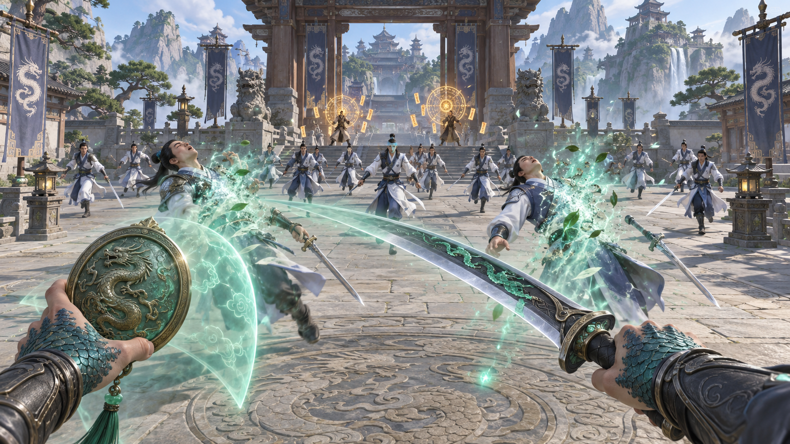
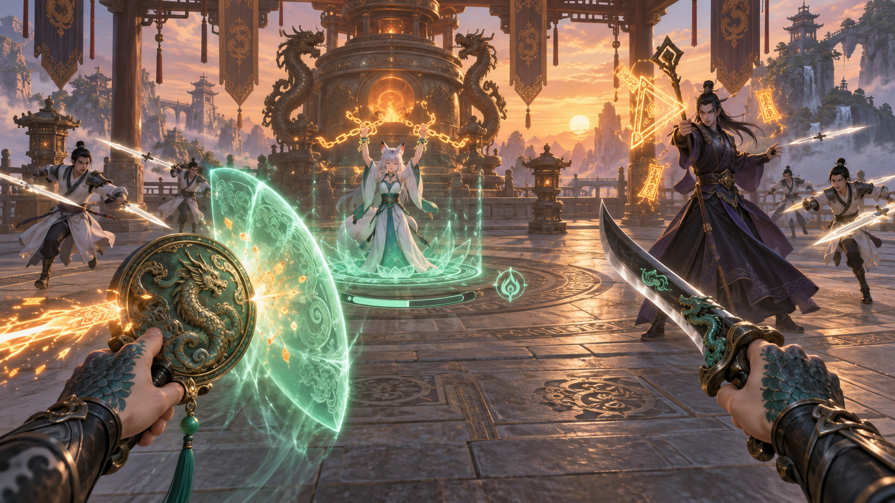
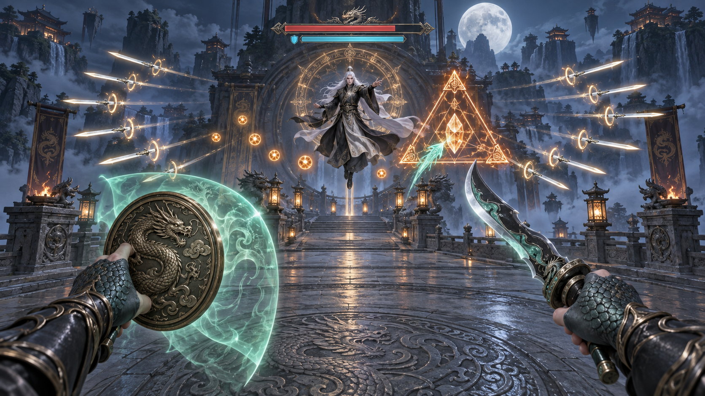
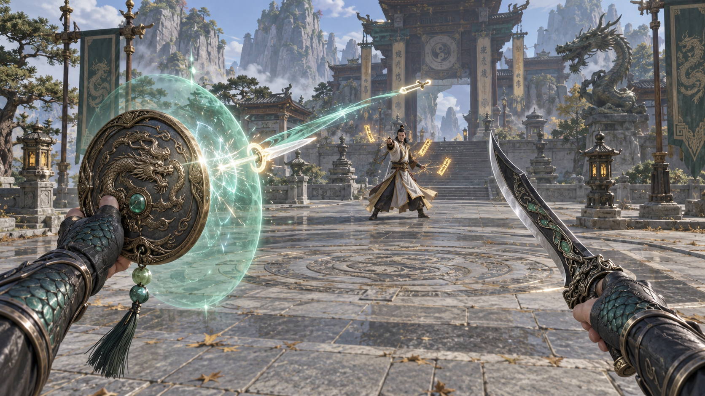

# 《逆鳞》VR 关键画面示意

版本：v0.1 ｜平台：PC VR，双手柄｜视角：第一人称

阅读方式：将本文件与 `images/` 文件夹放在同一目录，使用支持 Markdown 图片预览的编辑器打开。完整压缩包包含本文件和四张 PNG 图片。

本文用于讨论画面构图、威胁可读性和双手战斗表现。装备采用 GDD v0.1 的建议方案：右手逆鳞刃、左手护心镜；角色、装备外观和 UI 仍可调整。图中效果是概念示意，最终以实机体验为准。

## 01 第一关：破山门——群体割草



玩家停在山门内的战斗点，前方近战弟子成组逼近，远处御符弟子准备攻击。右手挥砍击败前排敌人，灵气向武器汇入；左手法宝保留清晰轮廓，不遮住中心视野。

- **构图重点：**近处攻击对象、中距离待进攻人群和远处施法者形成三个层次。
- **操作意图：**近战清群，同时观察远程预警；敌人数量多，但有效攻击错开出现。
- **可读性：**敌人的武器、身体轮廓和施法前摇比装饰特效更醒目。
- **实现约束：**击败特效短暂出现，不让尸体、粒子或巨大刀光持续遮挡后续攻击。

## 02 第二关：守丹台——保护解救法阵



挚友位于前方中央的逆转法阵内。左手屏障拦截射向法阵的攻击，右手武器指向侧前方的破阵修士；普通弟子从两侧前方形成压力。

- **构图重点：**法阵和挚友始终位于玩家容易观察的区域，破阵修士具有不同于杂兵的轮廓和施法符阵。
- **操作意图：**判断攻击目标，优先处理破阵修士，在攻击与保护法阵之间切换。
- **UI 建议：**解救进度与法阵完整度使用分开的图形；示意图无需依靠文字辨认。
- **实现约束：**关键拦截轨迹经过玩家自然伸手可覆盖的范围，不要求转身保护背后目标。

## 03 第三关：逆鳞劫——弹幕 Boss 战



宗主悬于出口前方，以分组飞剑和符弹封锁通路。玩家双手位于视野下缘，前方可同时辨认正在接近的攻击、下一组预警，以及宗主身边可击破的蓄力阵眼。

- **构图重点：**弹幕从前方分层接近，宗主和阵眼不被弹丸与特效淹没。
- **操作意图：**格挡普通弹丸、精准反弹飞剑、发射刃气打断蓄阵，在护阵崩解后输出。
- **攻击语言：**普通攻击用实心符弹；可反弹攻击用明确剑形与环形标记；需要打断的攻击用橙色阵眼及蓄力动画。不能只靠颜色区分。
- **实现约束：**画面表现密集压力，但实际攻击有节拍与间隙；不会要求玩家在房间中大幅跑动。

## 04 战斗特写：精准格挡与反弹



飞剑刚与左手护心镜的屏障接触，接触点产生短促而清晰的光环；反弹飞剑沿可见轨迹回到攻击者。右手逆鳞刃保持可见，准备接续反击。

为解释动作，画面同时示意入射轨迹与反弹轨迹；实际游戏按时间顺序呈现这一过程。

- **构图重点：**屏障边缘、飞剑接触点和反弹方向清楚，镜面不过度遮挡前方。
- **操作意图：**把“及时举镜”与“攻击被成功反弹”的因果表现放在同一瞬间。
- **反馈建议：**精准格挡采用独特清脆音效、短震动与局部光环，与普通格挡明显区分。
- **实现约束：**特效集中在接触点，不使用摄像机震动、强制后仰或全屏白闪。

## 统一画面规范

| 项目 | 方向 |
|---|---|
| 玩家视角 | 真实第一人称，仅出现双手与装备，不出现第三人称主角身体 |
| 主手装备 | 深色金属逆鳞刃，少量青绿色鳞纹与能量流动 |
| 副手装备 | 圆形古铜护心镜，龙纹边框，青绿色局部防御屏障 |
| 玩家辨识 | 手背与前臂少量龙鳞，保持类人双手，适合手柄操作 |
| 美术 | 风格化修仙幻想，清楚的轮廓与空间层次 |
| 宗门辨识 | 石阶、木构、丹炉、规整飞剑、符阵与法器 |
| 玩家力量 | 青绿色有机鳞纹与灵气；不以颜色作为唯一规则提示 |
| 敌方攻击 | 飞剑、实心符弹、橙色蓄力阵眼，通过形状及动作区分 |
| UI | 轻量世界内提示，避免大面积悬浮菜单与中心遮挡 |
| VR 舒适性 | 稳定地平线、自然手部位置、前方可读威胁，无镜头摇晃 |

## 用于后续评审的问题

1. 不看说明，是否能认出每张图的主要目标和当前威胁？
2. 双手装备是否清楚，同时保留足够的敌人观察空间？
3. 普通弹丸、可反弹飞剑、需要打断的阵眼能否靠形状区分？
4. 守点图是否让玩家理解自己在保护谁、优先攻击谁？
5. Boss 图是否有强压迫感，同时保留可执行的格挡和反击机会？

## 附录：生成方式与完整提示词

使用内置 image_gen 工具生成。以下为本次使用的完整提示词；每张图的输入为“统一提示词”加上该图的“场景提示词”。

<details>
<summary>展开统一提示词</summary>

```text
Use case: stylized-concept.
Asset type: first-person PC VR game keyframe concept for a game design document.
Create ONE single widescreen 16:9 landscape game-view illustration, clean readable high quality stylized 3D game concept, Chinese xianxia fantasy, painterly materials but crisp gameplay silhouettes. This is the view THROUGH the player's eyes, never show a third-person protagonist. Stable level horizon, moderate wide angle without fisheye distortion. Exactly TWO player hands in the lower corners: RIGHT hand has dark teal dragon scales across the back and a dark bracer, firmly holding a single-edged dark-metal curved short sword with a silver cutting edge, small jade-green dragon-scale inlays, restrained jade light; LEFT hand has the same scales and bracer and holds a round bronze dragon-engraved magic mirror with a jade-green translucent directional shield projected from it. Keep this EXACT equipment design and anatomy consistent throughout this concept series. Hands are naturally extended, fingers anatomically coherent, weapons not cut off by frame. No guns, no modern objects. Player jade magic contrasted with enemy ivory flying swords and warm amber talismans. Distinguish attacks by shape as well as color. Chinese wood-and-stone sect architecture, understated carved dragon motifs. Centre of view remains readable. Threats only in the frontal field. Sparse diegetic UI only, no text, no letters, no digits, no logos, no watermark. Illustrate plausible gameplay spacing, not a movie poster, no large labels or explanatory arrows.
```

</details>

<details>
<summary>01_破山门.png：场景提示词</summary>

```text
Scene/backdrop: DAYLIGHT, a spacious stone courtyard immediately inside a mountain cultivation sect's imposing timber gate, layered roofs and distant peaks. FIRST LEVEL, crowd-clearing combat.
Composition/action: camera stationary at a combat node. RIGHT sword is visibly sweeping through the front row, its full blade visible diagonally from bottom right toward centre-left, with a SHORT restrained jade slash arc that does not obscure enemies. LEFT mirror at bottom left is tilted ready to defend, with only a small faint shield. Two close disciples at about 2 metres are being defeated, dissolving into jade spirit wisps flowing toward the sword. Behind them 12 to 16 white-and-indigo sword disciples approach in separated groups, with two distant talisman casters at 7 metres charging distinct amber circular glyphs. Depict mass battle while only a couple of enemies are actually attacking. Front row has clear bodies, weapons, and readable distances; crowd has room to breathe. Player equipment fills at most lower quarter. Lighting/mood: clear morning light, kinetic power fantasy. No chaotic particle wall, no blood, no gore.
```

</details>

<details>
<summary>02_守丹台.png：场景提示词</summary>

```text
Scene/backdrop: warm sunset in a spacious open-sided alchemy hall, carved stone terrace, large bronze alchemy furnace in the back. SECOND LEVEL, defend a rescue ritual.
Composition/action: FIRST PERSON stationary defending. In central midground at 4 metres, the player's FRIEND, a distinct young adult humanoid fox spirit with two small fox ears and a white-and-teal robe, stands inside a small elevated jade-green circular release formation; faint broken amber binding ribbons above the wrists convey rescue, not crucifixion or injury. Circle and friend clearly visible. LEFT mirror in lower left projects a modest angled jade shield intercepting a single amber bolt aimed toward the ritual. RIGHT sword visible in lower right points toward a PRIORITY ritual-breaker caster at front-right, 6 metres away, wearing a dark indigo high-collared robe with a clearly visible angular staff and a large amber triangular casting glyph. Four ordinary sword disciples advance from the left and right frontal sides. The ritual's base has a sparse world-space incomplete circular progress ring and a separate small integrity glyph, no numbers or text. Clear target prioritisation and cause-and-effect: protect friend, defeat breaker. Moderate effects, no glowing cage that hides friend. Lighting/mood: urgent protective stand, warm furnace glow against jade rescue magic.
```

</details>

<details>
<summary>03_逆鳞劫.png：场景提示词</summary>

```text
Scene/backdrop: night at a broad stone exit bridge under a dramatic moon, sect roofs and misty mountains, a sealing gate behind the boss. THIRD LEVEL, readable bullet-pattern boss combat.
Composition/action: FIRST PERSON facing the enemy sect master at 10 metres in central upper-mid frame. Boss is a white-haired adult human in black-and-ivory xianxia robes floating slightly above a stone platform, physically human-sized but visually distinct, with a thin circular amber protective spell behind him. Exactly two natural player hands below: RIGHT holds the fully visible consistent curved dragon sword ready to fire a small jade blade-wave; LEFT holds consistent bronze dragon mirror and a modest transparent jade directional shield angled upward. In the frontal space, show THREE neatly separated rhythmic clusters of ivory flying swords, curved in a readable fan pattern, with small luminous RINGS on reflectable swords; show a smaller cluster of ROUND solid amber talisman orbs farther away, clearly a different shape. Leave gaps and open air, keep boss silhouette clear. On the boss's front-right at 8 metres, show a single LARGE ORANGE TRIANGULAR charged formation with a clearly solid breakable central crystal seal, a readable interrupt target. One jade projectile travels from sword toward this crystal. Threats appear at sensible distances, no bullets spawning right in face. Sparse world-space boss health and shield bars overhead WITHOUT text or numbers. Lighting/mood: high-pressure duel, dark blue night but hands, attacks and boss clearly lit. Not a dense bullet wall.
```

</details>

<details>
<summary>04_精准格挡.png：场景提示词</summary>

```text
Scene/backdrop: daylight sect courtyard with stone tiles, shallow focus on combat mechanics but the attacking talisman swordsman at 6 metres remains identifiable.
Composition/action: FIRST PERSON demonstration of a PERFECT PARRY. LEFT hand in lower-left holds the consistent round bronze dragon magic mirror, its surface and dragon rim clearly visible, angled across the frontal attack path. A modest translucent jade circular shield sits just ahead of mirror. A single IVORY flying sword with a distinctive luminous ring has JUST STRUCK the shield at centre-left, creating a LOCAL small bright impact ripple. Depict the same sword now rebounding away along ONE clear narrow jade-and-ivory trail toward the enemy at central midground; the path should visually read incoming trajectory turned back, not two disconnected swords. RIGHT hand lower-right holds the consistent dark curved dragon blade ready for follow-up, full blade visible and spatially separate from mirror. Keep impact localized and world clearly visible through shield, avoid full screen flashes and enormous bubbles. Natural human reach, anatomically correct TWO hands. Lighting/mood: precise skill success, restrained bright accent at point of contact. Gameplay concept frame, no arrows, no labels.
```

</details>

